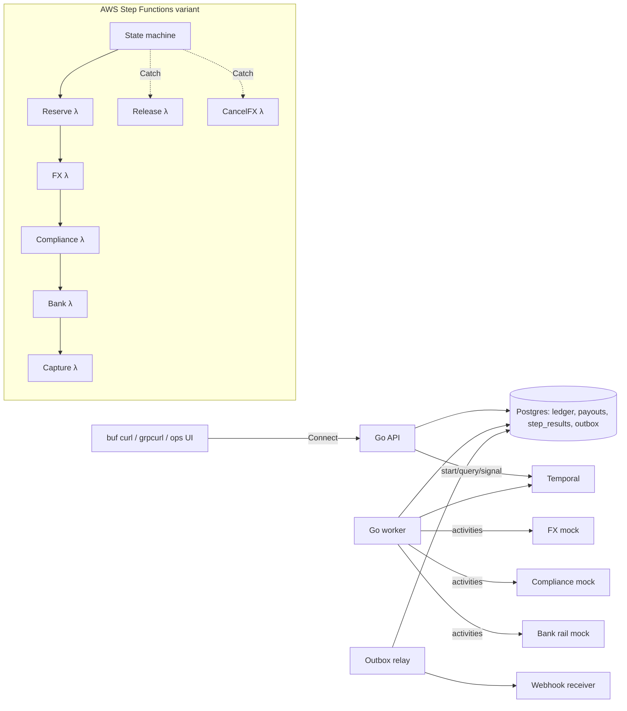

# Payout Saga Orchestrator

[](https://github.com/mini4141/payout-saga-orchestrator/actions/workflows/ci.yml)

Paying a merchant out takes six steps across four systems, and any of them can fail. This Go backend runs the payout
as a **Temporal saga** with idempotent activities, compensation, a transactional outbox and reconciliation. It can
prove that killing the worker or breaking the bank mid-flight never loses or duplicates money. The same saga also runs
on **AWS Step Functions** (nine Go Lambdas) for comparison.

- Proof of everything below: [proof/README.md](proof/README.md)
- Write-up: [docs/PORTFOLIO.md](docs/PORTFOLIO.md)
- Design: [docs/design/0001-payout-saga.md](docs/design/0001-payout-saga.md) (includes the failure-mode table) ·
  ADRs: [0001 ledger holds](docs/adr/0001-ledger-holds-and-step-idempotency.md),
  [0002 Temporal vs Step Functions](docs/adr/0002-temporal-vs-step-functions.md)
- Progress and decisions: [PROGRESS.md](PROGRESS.md), [docs/DECISIONS.md](docs/DECISIONS.md)

## Architecture



The saga: reserve funds (hold) → lock FX quote → compliance screening → bank transfer → capture the hold → notify
(status + outbox event in one transaction). On a definite failure the compensations run in reverse (`CancelFX`, `Release`).

## Quickstart (local)

Prerequisites: Go 1.26, Docker Desktop, [buf](https://buf.build), and (for tests) `go-junit-report`; Node for the screenshots.
On Windows use Git Bash; every script is POSIX `bash`.

```bash
cp .env.example .env              # optional, safe defaults
scripts/dev-up.sh                 # postgres, temporal dev server, migrate + seed, mocks, receiver, api, worker, relay, ops UI
```

| Service | URL |
|---|---|
| Ops UI | http://localhost:18081 |
| Temporal UI | http://localhost:18233 |
| Connect API | http://localhost:18080 (header `Authorization: Bearer dev-token`) |
| Mocks + admin | http://localhost:18090 |
| Webhook receiver | http://localhost:18095/delivered |

Create a payout (Connect over plain HTTP/JSON, `buf curl` and `grpcurl` all work):

```bash
curl -s -X POST localhost:18080/payout.v1.PayoutService/CreatePayout \
  -H 'Content-Type: application/json' -H 'Authorization: Bearer dev-token' \
  -d '{"merchantId":"m_acme","amountMinor":12500,"currency":"AUD","targetCurrency":"USD","bankAccount":"062-000-1234","idempotencyKey":"demo-1"}'

buf curl --protocol connect --http2-prior-knowledge --schema proto -H 'Authorization: Bearer dev-token' \
  -d '{"limit":5}' http://localhost:18080/payout.v1.PayoutService/ListPayouts

grpcurl -plaintext -H 'authorization: Bearer dev-token' -d '{"limit":5}' localhost:18080 payout.v1.PayoutService/ListPayouts
```

### Failure drills

Each drill asserts its own outcome and exits non-zero on failure; `check-invariants.sh` asserts the ledger.

| Drill | What it does |
|---|---|
| `scripts/drill-worker-kill.sh` | kills the worker while 10 payouts are inside `SendBankTransfer`; all resume and settle exactly once |
| `scripts/drill-bank-reject.sh` | bank returns `REJECTED`; hold released, FX lock cancelled, in reverse order |
| `scripts/drill-bank-timeout.sh` | bank times out twice (request processed, reply lost); retries with backoff, one transfer |
| `scripts/drill-recon.sh` | reconciliation is clean, then reports a mismatch seeded at the bank mock |
| `scripts/check-invariants.sh` | `balance = sum(entries)`, no leaked holds, one debit per success, one outbox event per payout |

### Tests

```bash
scripts/test-all.sh          # lint, unit + integration + e2e, all drills, invariants (starts the stack)
scripts/test-all.sh --ci     # cloud-free layers only (needs TEST_DATABASE_URL), what CI runs
scripts/capture-proof.sh phase1   # fresh stack + everything above + logs + screenshots into proof/phase1-local
```

Layers: Temporal testsuite (happy path, `BankRejected` compensation order) · Postgres integration (hold/capture/release,
idempotent activity replay) · Lambda handlers on the shared activities · ASL structure test · e2e smoke through Connect.

## Layout

```
proto/payout/v1/      Connect/Protobuf API (buf lint, breaking, generate)     gen/   generated code (committed)
internal/ledger/      hold / capture / release                                 internal/store/  sqlc output
internal/activities/  shared saga steps (Temporal worker and Lambdas)          internal/mock/   FX, compliance, bank mocks
workflows/            PayoutWorkflow, NotifyWorkflow (child), ReconciliationWorkflow
cmd/                  api worker relay receiver ops-ui mocks migrate  lambdas/{reserve,fx,compliance,bank,capture,release,cancelfx,notify,recon}
sfn/payout.asl.json   Step Functions definition       db/migrations, db/queries   goose + sqlc
infra/                Terraform                       scripts/   dev, drills, deploy, destroy, proof
```

## Deploy to AWS and destroy

Runs from this PC with the `payout-saga-orchestrator-deployer` profile in `ap-southeast-2` (Terraform state is local and gitignored).
GitHub Actions only builds and tests; it never holds AWS credentials.

```bash
scripts/deploy.sh                 # terraform → push images → migrate+seed (one-off Fargate task) → drills → Step Functions drill
scripts/capture-proof.sh phase2   # resources.txt, cloud e2e run, screenshots, CloudWatch graph
scripts/destroy.sh                # stop executions, scale ECS to 0, empty ECR, terraform destroy
scripts/verify-destroyed.sh       # exits non-zero if anything billable remains
```

Cloud topology: ECS Fargate (api, worker, relay, mocks, receiver, ops UI, Temporal dev server) in public subnets with
Cloud Map service discovery, one ALB (listeners restricted to the deployer's IP), RDS PostgreSQL 17 (`db.t4g.micro`, private),
Step Functions Standard + 9 Lambdas (VPC, `provided.al2023`), EventBridge Scheduler for the Lambda reconciliation,
CloudWatch logs (1-day retention), ECR. No NAT gateway. Everything is tagged `Project=payout-saga-orchestrator`, `Ephemeral=true`.

Temporal runs as the **dev server** (`temporal server start-dev`) locally and in the cloud. Production would use a
persistent cluster or Temporal Cloud (see [docs/tech-debt.md](docs/tech-debt.md)).

## Contributing

See [CONTRIBUTING.md](CONTRIBUTING.md) for the code-review checklist; AI usage is described in [docs/AI_USAGE.md](docs/AI_USAGE.md).
