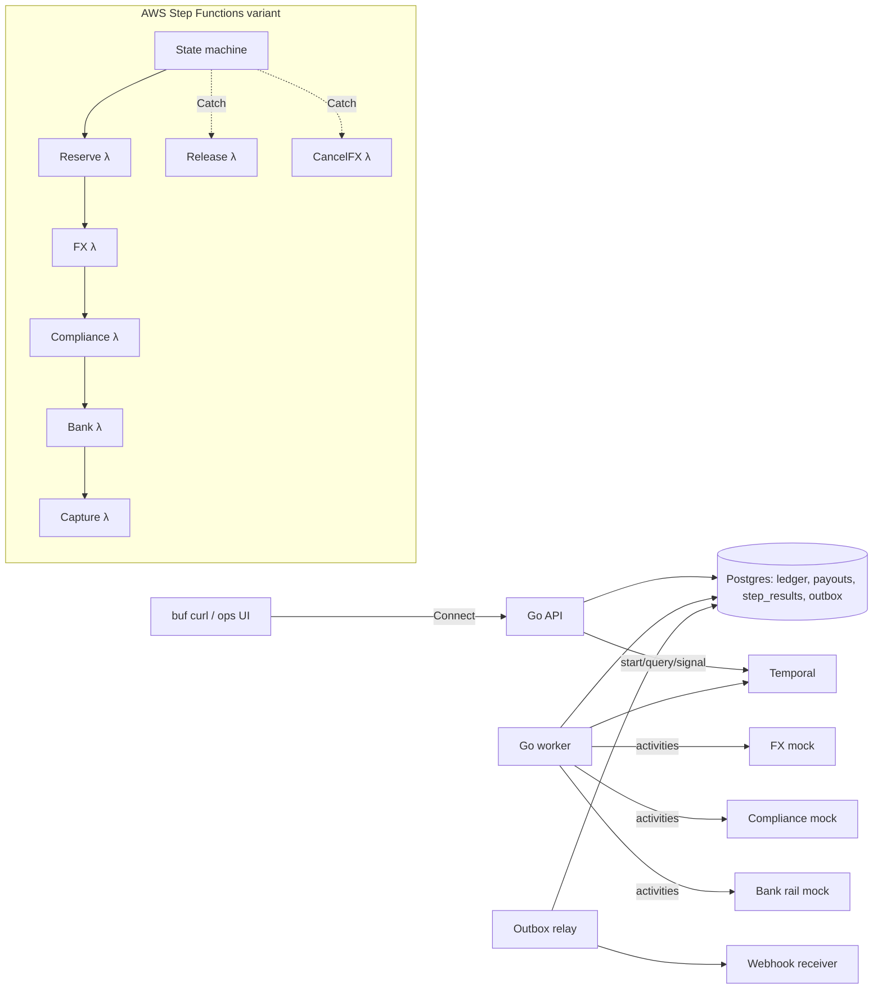

# SPECS.md: Payout Saga Orchestrator

## 1. Summary

A backend that pays merchants out from their balance to their bank account. A payout is a **multi-step distributed process**. Each step goes to a different system, and each step can fail or time out:

1. Reserve funds (hold).
2. Lock an FX quote.
3. Compliance screening.
4. Send the bank transfer.
5. Capture the hold.
6. Notify.

The service has to **stay correct and recover cleanly**: money is never lost or sent twice. Temporal orchestrates the saga, with compensations (release the hold, cancel the FX lock) when a step fails for good. Postgres holds the ledger, the idempotency records and an outbox. A nightly reconciliation compares the ledger with the bank. The same saga is also implemented on **AWS Step Functions** to compare the two orchestrators.

**Demo story:**
1. Create 10 payouts.
2. Kill the worker in the middle.
3. Make the bank reject one and time out on another.
4. Every payout ends `SUCCEEDED` or `COMPENSATED`, the invariants hold, and reconciliation is clean.
5. Then run the same drill on Step Functions.

## 2. Requirement coverage matrix

| Requirement | Covered by | Proof |
|---|---|---|
| Go backend services: data model → schema → deploy → operate | Go services, sqlc schema, Terraform, ECS | Repo + resources.txt |
| Multi-step processes that stay correct and recover when steps fail | Temporal saga + idempotent activities + compensation | Drill logs + invariants |
| Design proposals, technical docs | `docs/design/0001`, ADRs, failure-mode table | Docs |
| Design and code reviews | PR template + `CONTRIBUTING.md` review checklist | Repo |
| Reliability over time, tech debt | Reconciliation, metrics, `docs/tech-debt.md` | Report |
| Strong Go + relational DB design, distributed-systems trade-offs | Ledger with holds, outbox, at-least-once + idempotency | Tests |
| Workflow orchestration: Temporal **or** AWS Step Functions (nice to have) | Both | Temporal UI + SFN history |
| Payments / correctness domain | Ledger invariants, idempotency | Invariant checks |
| Zero to production (nice to have) | Full deploy to AWS | Phase 2 proof |
| Stack: Go, ConnectRPC/Protobuf, Temporal, PostgreSQL, AWS, Terraform | All | CI + proof |

## 3. Architecture



## 4. Repository layout

```
proto/payout/v1/      payout.proto
gen/                  generated code (committed)
internal/ledger/      sqlc queries, hold/capture/release
internal/activities/  shared activity implementations (used by Temporal + Lambdas)
cmd/api/  cmd/worker/  cmd/relay/  cmd/ops-ui/  cmd/mocks/  cmd/lambdas/{reserve,fx,compliance,bank,capture,release,cancelfx}/
workflows/            PayoutWorkflow, ReconciliationWorkflow
sfn/                  payout.asl.json
db/migrations/  db/queries/
infra/                Terraform
scripts/              drills: drill-worker-kill.sh, drill-bank-reject.sh, drill-bank-timeout.sh, drill-recon.sh, check-invariants.sh
docs/
```

## 5. Features (end-to-end)

### F1: Merchant balances and the payout API
- `CreatePayout{merchant_id, amount_minor, currency, target_currency, bank_account, idempotency_key}` → `payout_id`. Also `GetPayout`, `ListPayouts` and `CancelPayout` (a signal, allowed before step 4).
- Seed: 5 merchants with balances.
- **Accept:** creating a payout starts workflow `payout-<id>`, and repeating the idempotency key returns the same ID.

### F2: Payout saga (Temporal)
- The steps are activities with per-step retry policies. Step 4 has `StartToCloseTimeout` 10 s, up to 5 attempts and non-retryable error type `BankRejected`.
- Compensation stack: after step 1 push `Release`, after step 2 push `CancelFX`. On a non-retryable failure, run the compensations in reverse order.
- Query `status` returns the current step and attempts.
- **Accept:** the happy path ends SUCCEEDED; a rejection ends COMPENSATED with the hold released.

### F3: Outbox and notifications
- The state change and the outbox insert happen in one transaction. The relay polls, publishes to the webhook receiver and stdout, and marks rows sent (at-least-once). The receiver dedupes by event ID.
- **Accept:** each final payout produces exactly one delivered event in the receiver log.

### F4: Reconciliation
- `ReconciliationWorkflow` runs on a cron (every 5 minutes in the demo). It compares `payouts SUCCEEDED` with the bank mock's settled list, and writes `recon_reports` with matched, missing and mismatched counts.
- **Accept:** a seeded mismatch (inserted directly at the bank mock) is reported.

### F5: Ops dashboard
- Pages: payout list (status chips), payout detail (step timeline with attempts and timings, compensations), Failure injection (sliders per mock: fail rate, latency, reject next N), Reconciliation reports, and Invariants (current balance vs the sum of entries for each merchant).
- **Accept:** screenshots of each page with data.

### F6: Step Functions variant (AWS)
- `sfn/payout.asl.json`: Task states invoke the Go Lambdas. `Retry` on transient errors, `Catch` → the compensation branch. `scripts/sfn-drill.sh` starts 5 executions with different injected failures and saves `get-execution-history`.
- **Accept:** histories show the retries and a Catch → compensation path.

## 6. Data model

- `merchants(id, name, currency, balance_minor)`
- `ledger_entries(id, merchant_id, payout_id, kind{debit,credit}, amount_minor, at)`
- `holds(id, merchant_id, payout_id UNIQUE, amount_minor, at)`
- `payouts(id, merchant_id, amount_minor, currency, target_currency, bank_account, status, idempotency_key UNIQUE, created_at)`
- `step_results(payout_id, step, result jsonb, at, PRIMARY KEY(payout_id, step))`
- `outbox(id, aggregate_id, type, payload, created_at, sent_at)`
- `recon_reports(id, run_at, matched, missing, mismatched, details jsonb)`

## 7. Interfaces

- **`PayoutService`** (Connect): `CreatePayout`, `GetPayout`, `ListPayouts`, `CancelPayout`.
- **Ops UI:** `/`, `/payouts/{id}`, `/inject`, `/recon`, `/invariants`.
- **Mocks:**
  - `/fx/quote`, `/fx/cancel`
  - `/compliance/screen`
  - `/bank/transfer`, `/bank/settled`
  - `/admin/*`

## 8. Test plan

| Layer | Test |
|---|---|
| Temporal | Happy path; BankRejected → compensations called in reverse |
| Integration | Hold → capture changes the balance; release restores it; activity replay returns the stored result |
| Lambda | One handler unit test (bank) using the shared activity |
| e2e | Connect create → poll → SUCCEEDED |

## 9. Phase 1: Local

`docker compose` runs postgres, temporal dev, api, worker, relay, mocks, receiver and ops-ui.

- [ ] `tests/`: go test JUnit
- [ ] `logs/drill-worker-kill.log`, `drill-bank-reject.log`, `drill-bank-timeout.log`, `drill-recon.log`, `check-invariants.txt` (all PASS)
- [ ] `screenshots/01-payouts.png`, `02-payout-timeline-retries.png`, `03-compensated.png`, `04-inject.png`, `05-recon.png`, `06-invariants.png`, `07-temporal-ui.png`

## 10. Phase 2: AWS

| Local | AWS |
|---|---|
| compose | ECS Fargate (api, worker, relay, mocks, receiver, ops-ui, temporal dev) in public subnets, Cloud Map discovery |
| Postgres | RDS PostgreSQL |
| — | Step Functions Standard + 7 Go Lambdas (they call the mocks through the ALB) |
| cron workflow | Temporal cron + EventBridge Scheduler for the SFN reconciliation Lambda |

`scripts/deploy.sh`:
1. `terraform apply`.
2. Push images and Lambda zips.
3. Run migrations.
4. Seed.
5. Run all Temporal drills against the cloud.
6. `sfn-drill.sh`.

- [ ] `screenshots/01-cloud-ops-ui.png`, `02-cloud-timeline.png`, `03-cloud-invariants.png`
- [ ] `logs/sfn-executions.json`, `logs/sfn-history-compensation.json`, `logs/cloud-drills.log`, `resources.txt`

## 11. Phase 3: Destroy

`terraform destroy`.

`verify-destroyed.sh` checks for no state machines, Lambdas, ECS cluster, ALB, RDS instance or EventBridge schedules.

## 12. Out of scope

Real bank rails, multi-currency accounting depth, a persistent Temporal cluster, and auth beyond an API token.
