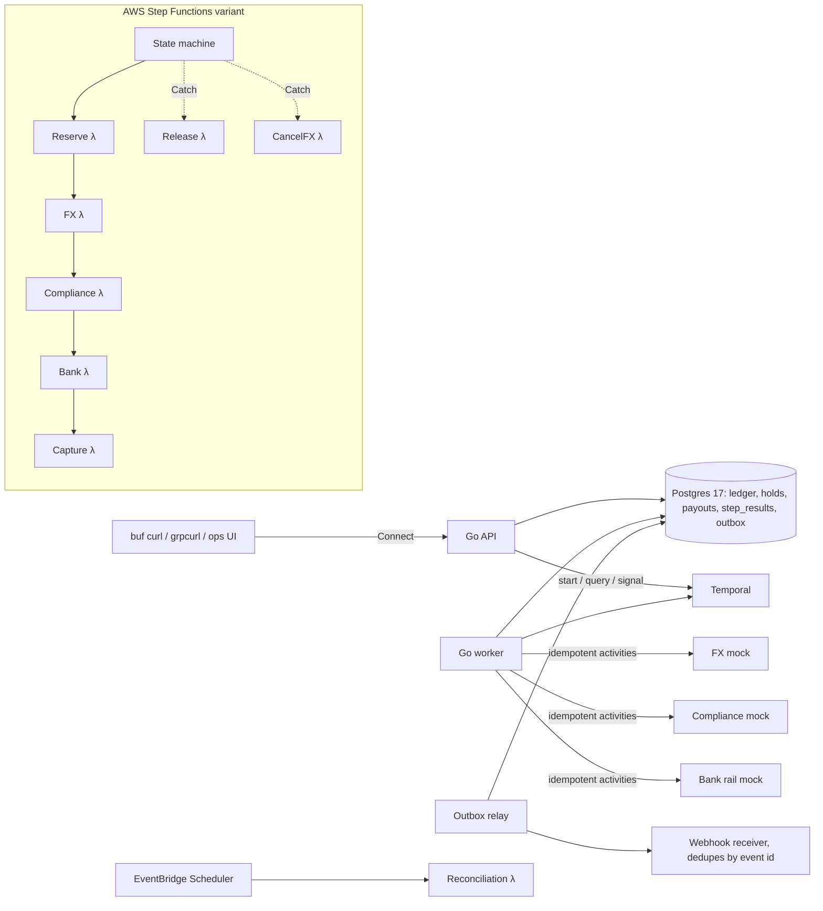
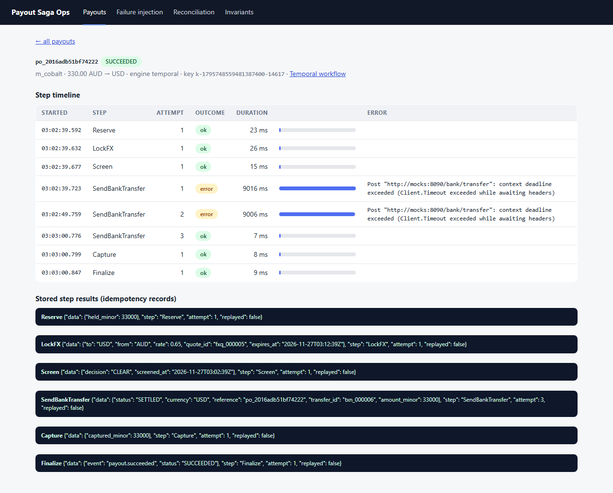
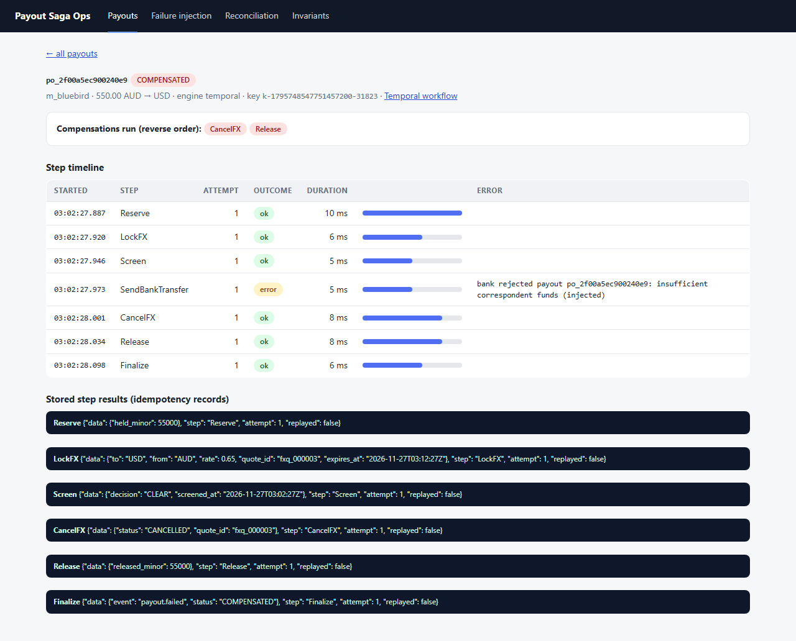
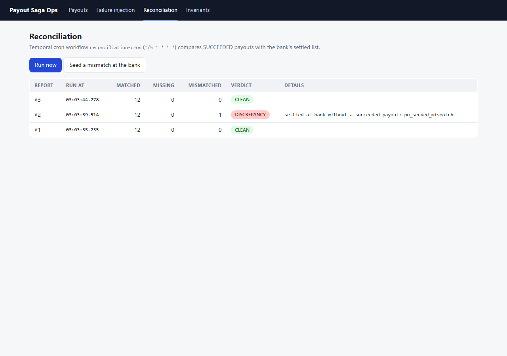
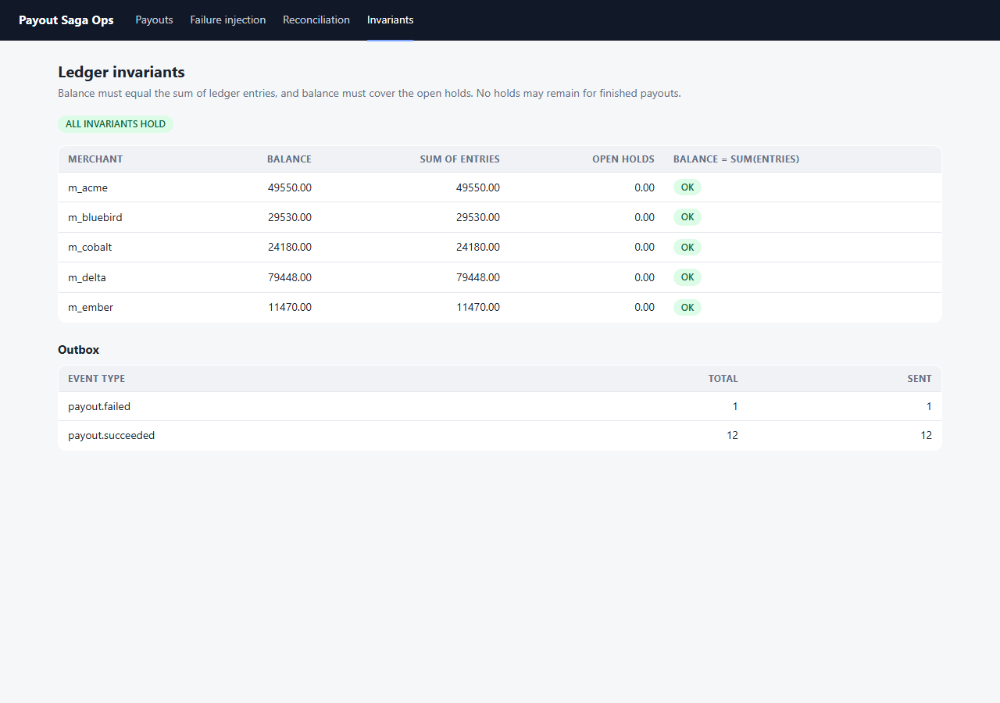
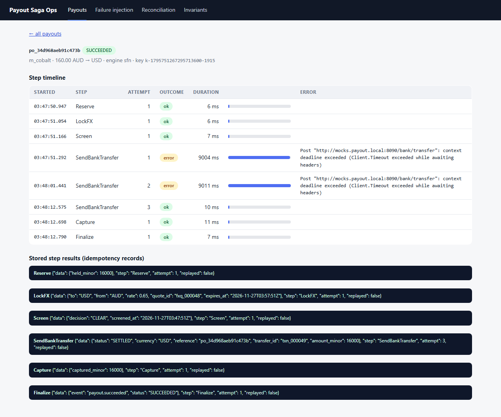
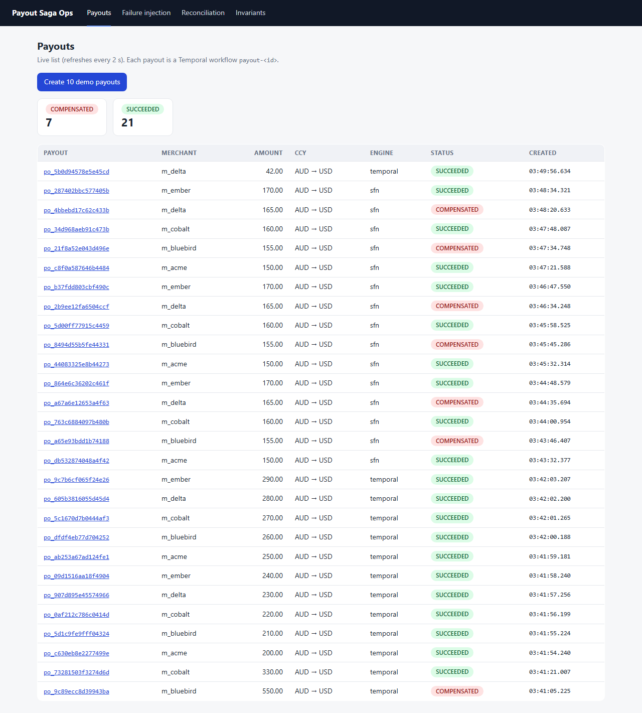

# Payout Saga Orchestrator: money that survives crashes

*A Go backend that pays merchants out through four unreliable systems, and proves that killing the worker or breaking
the bank mid-flight never loses or duplicates money. The same saga runs on Temporal and on AWS Step Functions.*

Repository: `payout-saga-orchestrator` · Proof index: [proof/README.md](../proof/README.md) · Design: [0001-payout-saga](design/0001-payout-saga.md)

## The problem

Paying a merchant out of their balance is six steps across four systems: reserve the funds in the ledger, lock an FX
quote, run compliance screening, send the bank transfer, capture the funds, notify. Each external system can be slow,
reject the request, or process it and then lose the reply. Our own workers can die at any instant. The requirement is
not "usually works" but **money is never lost and never sent twice**, and every payout ends in a state a human can explain.

## Architecture



Three ideas carry the correctness:

1. **Ledger holds.** `Reserve` places a hold (available = balance − holds), `Capture` turns it into a debit after the bank
   succeeded, `Release` deletes it. A failed payout leaves the books untouched: there is nothing to refund.
2. **Idempotent steps.** Every activity is keyed by `(payout_id, step)` in `step_results`; a replay returns the stored
   result. Every external call carries an idempotency key and the mocks honour it, so "the bank processed it but the reply
   was lost" resolves to the original transfer instead of a second one.
3. **Transactional outbox.** The status change and the `payout.succeeded` / `payout.failed` event commit in one
   transaction; a relay publishes at-least-once and the receiver dedupes by event ID.

Both orchestrators call the **same Go activity package**; only the control flow differs (Temporal workflow code vs ASL JSON).

## What it demonstrates, by requirement

| Requirement | Where it shows up | Proof |
|---|---|---|
| Go backend services, data model → schema → deploy → operate | `cmd/*`, goose migrations, sqlc, Terraform, ECS | [resources.txt](../proof/phase2-cloud/resources.txt) |
| Multi-step processes that stay correct and recover | Temporal saga, idempotent activities, compensation stack | [worker-kill drill](../proof/phase1-local/logs/drill-worker-kill.log), [invariants](../proof/phase1-local/logs/check-invariants.txt) |
| Relational design, distributed-systems trade-offs | holds, partial unique indexes, outbox, at-least-once + idempotency | `db/migrations/00001_init.sql`, [ADR 0001](adr/0001-ledger-holds-and-step-idempotency.md) |
| ConnectRPC + Protobuf | `proto/payout/v1`, `buf lint/generate`, Connect + gRPC on one port | [connect-examples.txt](../proof/phase1-local/logs/connect-examples.txt) |
| Temporal: saga, signals, queries, child workflow, cron | `workflows/payout.go` | [Temporal UI](../proof/phase1-local/screenshots/07-temporal-ui.png) |
| AWS Step Functions + Go Lambdas | `sfn/payout.asl.json`, `cmd/lambdas/*` (`provided.al2023`) | [SFN histories](../proof/phase2-cloud/logs/sfn-executions.json) |
| PostgreSQL 17, pgx, sqlc, goose | `db/`, `internal/store` | [integration tests](../proof/phase1-local/tests/go-test.log) |
| Mock dependencies with failure injection | `internal/mock` (FX, compliance, bank) + admin API | [inject UI](../proof/phase1-local/screenshots/04-inject.png) |
| Ops UI (`html/template` + htmx) | `cmd/ops-ui` | screenshots below |
| Observability | `slog` JSON, OpenTelemetry via the Temporal interceptor, Prometheus | [metrics](../proof/phase1-local/logs/metrics-worker.txt) |
| AWS: ECS Fargate, ALB, RDS, SFN, Lambda, EventBridge Scheduler, CloudWatch, ECR | `infra/` | [CloudWatch graph](../proof/phase2-cloud/screenshots/04-cloudwatch-sfn-lambda.png) |
| Terraform, GitHub Actions | `infra/`, `.github/workflows/ci.yml` | CI badge in the README |
| Design proposals, ADRs, reviews | [design doc](design/0001-payout-saga.md) with failure-mode table, [ADR 0002](adr/0002-temporal-vs-step-functions.md), `CONTRIBUTING.md` | docs |
| Reliability over time | reconciliation (cron workflow + EventBridge Lambda), metrics, [tech debt](tech-debt.md) | [recon](../proof/phase1-local/screenshots/05-recon.png) |

## Key evidence

**Killing the worker mid-transfer.** Ten payouts are inside `SendBankTransfer`; the bank has recorded each transfer but the
replies are held. The worker is killed, restarted, and every payout resumes: 10 SUCCEEDED, exactly one debit and one bank
transfer each, with the retries answered from the bank's idempotency record
([log](../proof/phase1-local/logs/drill-worker-kill.log)). The timeline shows the attempt the dead worker never finished.

**Bank timeouts, retried with backoff.** Two timeouts (request processed, reply lost), then success, one settled transfer.
The attempt table shows 9 s, 9 s, then 7 ms:



**Bank rejection compensates in reverse.** `CancelFX`, then `Release`; no debit, balance unchanged, `payout.failed` in the outbox:



**Reconciliation catches a seeded mismatch**, then goes clean again once it is removed:



**The ledger invariant holds after all of it:**



**The same saga on AWS Step Functions.** Five executions with injected failures. The bank-timeout execution retried the bank
Lambda twice (`Transient`) before succeeding; the bank-rejected execution took the `Catch` into `CompensateCancelFX →
CompensateRelease → FinalizeCompensated` ([history](../proof/phase2-cloud/logs/sfn-history-compensation.json),
[summary](../proof/phase2-cloud/logs/sfn-executions.json)). Same step timeline in the cloud ops UI:




## What was hard

- **Making "unknown" a first-class outcome.** After the bank call, a timeout does not mean failure: the transfer may have
  settled. Releasing the hold there would risk paying out money the ledger says is still ours. So only *definite* failures
  (`BankRejected`, `ComplianceRejected`, insufficient funds, a cancel before step 4) compensate; exhausted bank retries end in
  `NEEDS_REVIEW` with the hold kept.
- **Simulating a lost reply properly.** The bank mock records the transfer *before* it delays the reply, and replays of an
  idempotency key can be delayed too. That is what makes the timeout and worker-kill drills meaningful instead of cosmetic.
- **Two orchestrators, one source of truth.** Error names have to line up: Temporal's `NonRetryableErrorTypes` and the ASL
  `Catch` both match the Go type name (`BankRejected`), and a `Transient` type separates retryable infrastructure errors
  from definite ones in the ASL `Retry` blocks.
- **Lambdas without a NAT gateway.** VPC Lambdas cannot reach a public ALB, so they reach the mocks and RDS over Cloud Map
  private DNS inside the VPC.
- **Terraform ordering.** ECS services reference images that do not exist until ECR exists, and the schema must exist before
  traffic: infrastructure is applied with services at 0, images are pushed, a one-off Fargate task migrates the private RDS,
  then the services scale to 1.
- **Windows host quirks** surfaced in the scripts: `jq.exe` emits CRLF, native tools do not understand `/c/...` paths, and
  Lambda zips need an executable `bootstrap` bit that Windows tooling drops (the zip is written with explicit modes).
- **Dependency reality.** Every current dependency requires Go 1.26, so the project moved from the specified 1.25 (see
  [DECISIONS.md](DECISIONS.md)).

## Cost

The stack lived for well under two hours. Rough estimate for `ap-southeast-2`: seven small Fargate tasks (0.25 to 0.5 vCPU)
≈ $0.15/h, one ALB ≈ $0.03/h, RDS `db.t4g.micro` + 20 GB gp3 ≈ $0.03/h, public IPv4 addresses ≈ $0.05/h, Step Functions and
Lambda a few cents for ~30 executions. **About US$0.5 to $1 in total**, and `scripts/verify-destroyed.sh` confirms nothing is
left running ([output](../proof/phase3-destroy/verify-destroyed.txt)).

## Reproduce

```bash
scripts/dev-up.sh                  # local stack on Docker Compose
scripts/test-all.sh                # unit + integration + e2e + all drills + invariants
scripts/capture-proof.sh phase1    # regenerate the local proof (logs, tests, screenshots)

scripts/deploy.sh                  # AWS: terraform, images, migrations, drills, Step Functions drill (profile payout-saga-orchestrator-deployer)
scripts/capture-proof.sh phase2    # cloud proof
scripts/destroy.sh && scripts/verify-destroyed.sh
```

Temporal runs as the dev server (`temporal server start-dev`) locally and in the cloud; production would use a persistent
cluster or Temporal Cloud. That, and the other known gaps, are tracked in [tech-debt.md](tech-debt.md).
