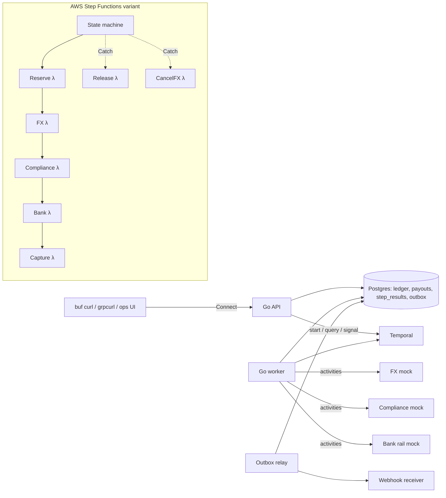

# Design proposal 0001: Payout saga

Status: implemented · Authors: project owner · Reviewers: see `CONTRIBUTING.md` checklist

## 1. Problem

A merchant asks to be paid out from their balance to their bank account. Doing that touches four systems:
our ledger (Postgres), an FX provider, a compliance screen and a bank rail. Each can be slow, return an error,
or time out after having done the work. Our own workers can also die at any point.

The product requirement is stricter than "usually works": **money is never lost and never sent twice**, and every
payout ends in a state a human can reason about (`SUCCEEDED`, `COMPENSATED`, or `NEEDS_REVIEW`).

## 2. Goals and non-goals

Goals
- A payout is a durable, resumable process: killing any process at any instant leaves the system recoverable.
- Every side effect is idempotent, so retries and replays are safe.
- Business events (`payout.succeeded`, `payout.failed`) are never lost and never invented.
- The ledger invariant `balance = sum(entries)` holds after every failure drill.
- The same saga runs on two orchestrators so that the trade-offs are visible (see ADR 0002).

Non-goals: real bank rails, multi-currency accounting, a persistent Temporal cluster, auth beyond one API token.

## 3. Architecture

Both orchestrators call the **same Go activity package** (`internal/activities`); only the control flow differs
(`workflows/payout.go` vs `sfn/payout.asl.json`).

## 4. The saga

| # | Step | Side effect | Compensation | Retry |
|---|------|-------------|--------------|-------|
| 1 | `Reserve` | hold on merchant funds (available = balance − holds) | `Release` deletes the hold | 3×, `InsufficientFunds` is final |
| 2 | `LockFX` | FX quote | `CancelFX` | 5× |
| 3 | `Screen` | compliance decision | none | 5×, `ComplianceRejected` is final |
| 4 | `SendBankTransfer` | money leaves | none: after this step we go forward | 5× with backoff, 10 s per attempt, `BankRejected` is final |
| 5 | `Capture` | hold becomes a debit entry | none | unlimited |
| 6 | `Finalize` (child workflow) | final status **and** outbox event, one transaction | none | unlimited |

Compensations are pushed onto a stack after steps 1 and 2 and run in reverse order (`CancelFX`, then `Release`)
on a *definite* failure: `BankRejected`, `ComplianceRejected`, `InsufficientFunds` or a merchant cancel.
`CancelPayout` is a signal checked before step 4 only, because after the bank call the money may already be gone.

If step 4 exhausts its retries the outcome is **unknown** (the transfer may have settled and only the reply was
lost). We must not release the hold, so the payout becomes `NEEDS_REVIEW` with the hold kept and reconciliation
flags any divergence.

Temporal features used: activities with per-step retry policies and non-retryable error types, a compensation
stack with a disconnected context, a `status` query (current step, attempts per step, compensations run), a
`cancel` signal, a child workflow for step 6 and a cron workflow for reconciliation.

## 5. Data model

`merchants`, `ledger_entries`, `holds`, `payouts`, `step_results`, `outbox`, `recon_reports` as in `SPECS.md` §6,
plus `step_attempts` (one row per attempt with outcome and duration: it feeds the ops UI timeline and shows
retries and attempts lost to a dead worker).

Key constraints
- `payouts.idempotency_key UNIQUE`: repeating `CreatePayout` returns the same payout.
- `holds.payout_id UNIQUE`, partial unique index on debit entries per payout: a payout is held once and captured once.
- `step_results PRIMARY KEY (payout_id, step)`: the idempotency record of every activity.
- Opening balances are credit entries, so `merchants.balance_minor = sum(ledger_entries)` is literally true.

## 6. Correctness mechanisms

1. **Activity idempotency.** `run()` in `internal/activities` looks up `(payout_id, step)` in `step_results`; a hit
   returns the stored result. For ledger steps the work and the `step_results` insert commit in one transaction;
   for external calls the stored result is written after the call.
2. **Idempotent external calls.** Every mock call carries `Idempotency-Key: <payout_id>:<step>`; the mocks honour
   it. If the worker dies after the bank accepted the transfer but before we stored the answer, the retry returns the
   original transfer instead of sending another.
3. **Ledger holds.** `Reserve` locks the merchant row (`FOR UPDATE`), inserts the hold and checks
   `balance − holds ≥ 0`; `Capture` deletes the hold and writes a debit in one transaction; `Release` deletes the hold.
4. **Transactional outbox.** `Finalize` updates `payouts.status` and inserts the outbox row in one transaction. The
   relay polls with `FOR UPDATE SKIP LOCKED`, publishes to stdout and the webhook, then marks the row sent.
   A crash between publish and mark re-publishes (at-least-once); the receiver dedupes by event ID.
5. **Reconciliation.** Every five minutes, `SUCCEEDED` payouts are compared with the bank's settled list:
   *missing* (we think paid, bank disagrees), *mismatched* (amount differs, or bank settled something we did not record).

## 7. Failure-mode table

| Failure | Where | What happens | Why it is safe | Proof |
|---|---|---|---|---|
| Worker killed mid-`SendBankTransfer` | worker | attempt times out (10 s), Temporal retries on the restarted worker | bank dedupes on idempotency key; `step_results` replay | `drill-worker-kill.log` |
| Bank returns `REJECTED` | bank | non-retryable `BankRejected` → `CancelFX`, then `Release` → `COMPENSATED` | no debit was written; hold is deleted | `drill-bank-reject.log` |
| Bank timeout (request processed, reply lost) | bank | activity times out, retries with backoff, succeeds | bank returns the stored transfer for the key | `drill-bank-timeout.log` |
| Bank retries exhausted | bank | `NEEDS_REVIEW`, hold kept | outcome unknown, so money stays reserved | design (not drilled) |
| Compliance blocks | compliance | `ComplianceRejected` → compensations | as above | `compliance-blocked` scenario in the Step Functions drill |
| FX or compliance 5xx | mocks | retried with backoff | idempotent calls | mock injection |
| Insufficient funds | ledger | `Reserve` rolls back, `COMPENSATED` with reason | hold insert and check are one transaction | `TestReserveRejectsInsufficientFunds` |
| Worker dies after commit, before ack | worker | activity re-runs, returns stored result | `step_results` hit | `TestActivityReplayReturnsStoredResult` |
| Relay dies between publish and mark | relay | event re-published | receiver dedupes by event ID | receiver log |
| Postgres unavailable | all | activities fail and retry; API returns 5xx | state only changes through transactions | n/a |
| Temporal dev server restarted | temporal | in-flight workflows are lost (dev server is in-memory) | **known gap**: production needs a persistent cluster; see `docs/tech-debt.md` | n/a |
| Bank and ledger disagree | both | reconciliation report | detection, not prevention | `drill-recon.log` |

## 8. Observability

`slog` JSON logs on stdout, OpenTelemetry traces through the Temporal tracing interceptor (client and worker),
Prometheus metrics on `/metrics` (`api_requests_total`, `payout_step_attempts_total`, `payout_finalized_total`,
`outbox_published_total`, `receiver_events_total`), and the ops UI for humans.

## 9. Alternatives considered

- **Two-phase commit** across ledger and bank: the bank does not support it.
- **Just a queue and a state column**: possible, but we would be rebuilding durable timers, retries, signals
  and visibility. See ADR 0002 for the comparison with Step Functions.
- **Capture before the bank call**: simpler, but then a rejected transfer needs a *refund* instead of deleting a hold.
  Holds make the failure case a no-op on the books.

## 10. Rollout and operations

Local: `docker compose` (`scripts/dev-up.sh`). Cloud: Terraform to ECS Fargate, RDS, Step Functions
and Lambdas, deployed and destroyed by scripts (`scripts/deploy.sh`, `scripts/destroy.sh`). Temporal runs as the dev
server in both; production would use a persistent cluster or Temporal Cloud.
